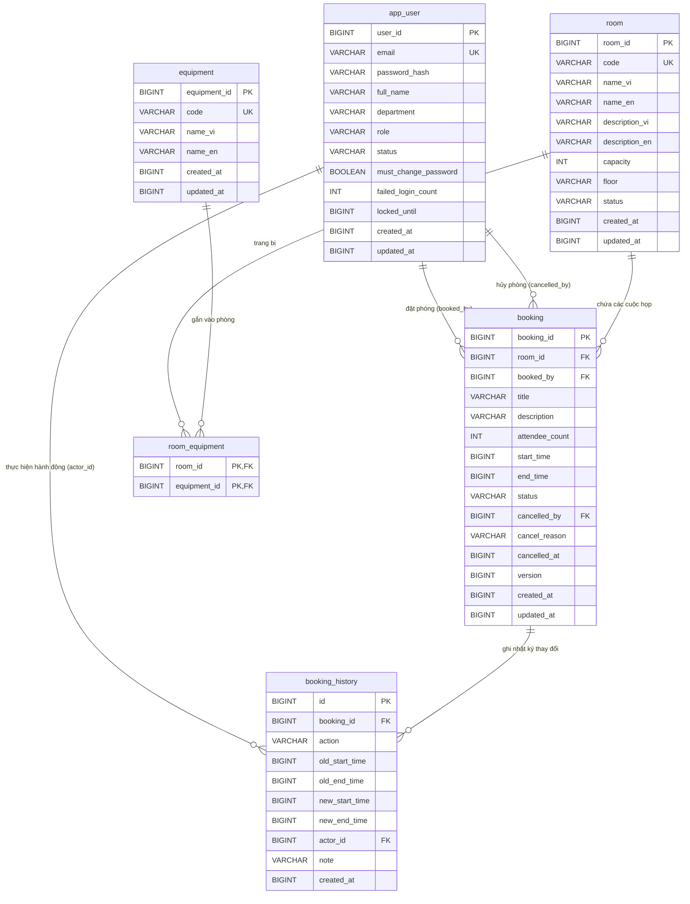
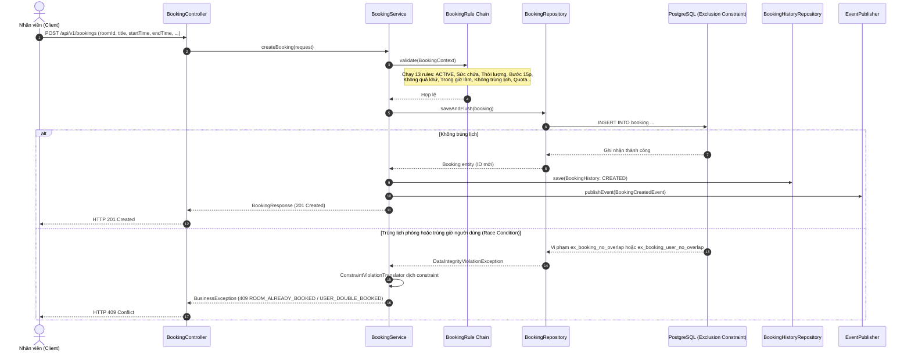

# Meeting Room Booking Service

Dịch vụ backend REST API quản lý và đặt phòng họp nội bộ dành cho doanh nghiệp (~10 phòng họp, ~200 nhân viên), **không trùng lịch** (Zero-double-booking) tuyệt đối thông qua cơ chế ràng buộc toàn vẹn ở tầng cơ sở dữ liệu PostgreSQL.

---

## 1. Giới thiệu

### Tính năng chính
- **Xác thực & Bảo mật:** JWT Stateless (Access Token + Refresh Token), mã hóa mật khẩu bằng BCrypt, chính sách bắt buộc đổi mật khẩu ở lần đăng nhập đầu tiên, tự động khóa tạm tài khoản khi đăng nhập sai quá số lần quy định.
- **Quản lý phòng & Tiện ích:** Hỗ trợ CRUD phòng họp và danh mục tiện ích, tra cứu với bộ lọc linh hoạt (từ khóa, sức chứa, tiện ích bắt buộc), cơ chế an toàn khi đưa phòng vào bảo dưỡng hoặc giảm sức chứa.
- **Đặt phòng & Quy tắc nghiệp vụ:** Kiểm tra giờ làm việc, ngày làm việc, giới hạn thời lượng, bước thời gian, giới hạn đặt trước, quota phòng cá nhân thông qua kiến trúc Chain of Responsibility / Strategy.
- **Chống trùng lịch hai lớp (Two-tier Conflict Prevention):** Kết hợp kiểm tra sớm bằng ứng dụng để trả về thông điệp thân thiện và chốt chặn cuối bằng PostgreSQL Exclusion Constraint.
- **Nhật ký thay đổi (Audit History):** Lưu vết toàn bộ lịch sử tạo, đổi giờ, hủy cuộc họp cùng định danh người thực hiện phục vụ đối soát.
- **Bản địa hóa (i18n):** Song ngữ Anh - Việt cho các trường nội dung hệ thống (`{vi, en}`) và thông báo lỗi theo header `Accept-Language`.

---

## 2. Cách chạy hệ thống

### 2.1 Yêu cầu môi trường
- **Docker** và **Docker Compose** (Docker Desktop hoặc Docker Engine trên Linux/macOS/Windows).
- Tiện ích dòng lệnh `curl` hoặc trình duyệt web để kiểm tra.

### 2.2 Các bước khởi chạy

#### Bước 1: Tạo file cấu hình môi trường `.env`
Hệ thống tuân thủ nguyên tắc không lưu trữ bí mật (secrets) mặc định trong mã nguồn. Bạn cần tạo file `.env` từ file mẫu:
```bash
cp .env.example .env
```

#### Bước 2: Điền các thông số bí mật trong `.env`
Mở file `.env` và thay thế các chuỗi giữ chỗ (`change-me-...`). 
> **Mẹo tạo khóa bí mật cho `JWT_SECRET`:** Chạy lệnh sau để sinh chuỗi ngẫu nhiên chuẩn base64:
> ```bash
> openssl rand -base64 48
> ```

Ví dụ cấu hình mẫu hợp lệ trong `.env`:
```env
POSTGRES_DB=meeting_room
POSTGRES_PORT=5432
SPRING_DATASOURCE_USERNAME=postgres
SPRING_DATASOURCE_PASSWORD=StrongDbPassword_2026

PORT=8080
JWT_SECRET=c3VwZXJfc2VjdXJlX2tleV9mb3Jfand0X3NpZ25pbmdfd2l0aF9hdF9sZWFzdF8zMl9ieXRlc18yMDI2
JWT_ACCESS_TTL_MINUTES=30
JWT_REFRESH_TTL_DAYS=7

APP_ADMIN_EMAIL=admin@company.com
APP_ADMIN_PASSWORD=AdminSecure@2026

APP_TIMEZONE=Asia/Ho_Chi_Minh
APP_SEED_DEMO_DATA=true
```

> **Cảnh báo Fail-fast:** Khi khởi động, ứng dụng sẽ tự động từ chối chạy nếu `JWT_SECRET` ngắn hơn 32 byte hoặc còn chứa giá trị placeholder, hoặc nếu `APP_ADMIN_PASSWORD` không đạt chính sách bảo mật (tối thiểu 8 ký tự, có cả chữ và số) hoặc còn là placeholder.

#### Bước 3: Khởi chạy container
Chạy toàn bộ dịch vụ (Cơ sở dữ liệu PostgreSQL + Ứng dụng Spring Boot):
```bash
docker compose up --build -d
```

#### Bước 4: Kiểm tra trạng thái và truy cập dịch vụ
- **Swagger UI (Tài liệu API tương tác):** [http://localhost:8080/swagger-ui.html](http://localhost:8080/swagger-ui.html)
- **Actuator Health Check:** [http://localhost:8080/actuator/health](http://localhost:8080/actuator/health)
- **OpenAPI Schema JSON:** [http://localhost:8080/v3/api-docs](http://localhost:8080/v3/api-docs)

#### Bước 5: Dừng dịch vụ hoặc xóa dữ liệu
- Dừng hệ thống:
  ```bash
  docker compose down
  ```
- Dừng hệ thống và xóa sạch dữ liệu database volume:
  ```bash
  docker compose down -v
  ```

---

## 3. Hướng dẫn dùng nhanh (Quickstart bằng `curl`)

Dưới đây là kịch bản trải nghiệm luồng nghiệp vụ điển hình bằng các lệnh `curl`:

### Bước 3.1: Đăng nhập tài khoản Quản trị viên
```bash
curl -X POST http://localhost:8080/api/v1/auth/login \
  -H "Content-Type: application/json" \
  -d '{
    "email": "admin@company.com",
    "password": "AdminSecure@2026"
  }'
```
*Kết quả trả về gồm `accessToken`, `refreshToken` và cờ `mustChangePassword: true`.*

### Bước 3.2: Đổi mật khẩu bắt buộc ở lần đầu đăng nhập
```bash
curl -X POST http://localhost:8080/api/v1/auth/change-password \
  -H "Content-Type: application/json" \
  -H "Authorization: Bearer <ACCESS_TOKEN>" \
  -d '{
    "currentPassword": "AdminSecure@2026",
    "newPassword": "AdminPermanentPassword@2026"
  }'
```

### Bước 3.3: Xem danh sách phòng họp sẵn có
```bash
curl -X GET "http://localhost:8080/api/v1/rooms?page=0&size=10" \
  -H "Authorization: Bearer <ACCESS_TOKEN>"
```

### Bước 3.4: Tìm phòng trống cho cuộc họp 10 người
Khung giờ: 10:00 - 11:00 ngày làm việc kế tiếp (thời gian dạng epoch ms UTC):
```bash
curl -X GET "http://localhost:8080/api/v1/rooms/available?startTime=1788321600000&endTime=1788325200000&minCapacity=10" \
  -H "Authorization: Bearer <ACCESS_TOKEN>"
```

### Bước 3.5: Đặt phòng họp
```bash
curl -X POST http://localhost:8080/api/v1/bookings \
  -H "Content-Type: application/json" \
  -H "Authorization: Bearer <ACCESS_TOKEN>" \
  -d '{
    "roomId": 1,
    "title": "Họp kế hoạch Sprint 24",
    "description": "Thảo luận mục tiêu sprint và phân công công việc",
    "attendeeCount": 4,
    "startTime": 1788321600000,
    "endTime": 1788325200000
  }'
```
*Kết quả trả về HTTP 201 Created cùng mã `bookingId`.*

### Bước 3.6: Xem lịch biểu của phòng họp
```bash
curl -X GET "http://localhost:8080/api/v1/rooms/1/calendar?fromTime=1788316800000&toTime=1788403200000" \
  -H "Authorization: Bearer <ACCESS_TOKEN>"
```

### Bước 3.7: Hủy lịch đặt phòng
```bash
curl -X POST http://localhost:8080/api/v1/bookings/<BOOKING_ID>/cancel \
  -H "Content-Type: application/json" \
  -H "Authorization: Bearer <ACCESS_TOKEN>" \
  -d '{
    "reason": "Khách hàng dời lịch làm việc sang tuần sau"
  }'
```

---

## 4. Kiến trúc & Thiết kế hệ thống

### 4.1 Mô hình phân tầng (Layered Architecture)
Hệ thống tuân thủ nghiêm ngặt mô hình phụ thuộc một chiều:
```
[Client (HTTP / Swagger)]
           │
           ▼
[Controller Layer]       - Xử lý HTTP request/response, validation DTO (@Valid)
           │
           ▼
[Service Layer]          - Nghiệp vụ, điều phối Rule Engine, Strategy, Transactions (@Transactional)
           │
           ▼
[Repository Layer]       - Truy vấn cơ sở dữ liệu qua Spring Data JPA
           │
           ▼
[PostgreSQL Database]    - Bảng dữ liệu, Exclusion Constraints, B-Tree & GIST Indexes
```

### 4.2 Cấu trúc thư mục mã nguồn
```
src/main/java/com/company/roombooking
├── RoomBookingApplication.java         # Điểm khởi chạy ứng dụng Spring Boot
├── config/                             # Cấu hình Security, OpenAPI, i18n, Startup Checks, Seeder
│   ├── AppStartupValidator.java
│   ├── BookingProperties.java
│   ├── DemoDataSeeder.java
│   ├── I18nConfig.java
│   ├── OpenApiConfig.java
│   └── SecurityConfig.java
├── common/                             # Các thành phần tái sử dụng chung toàn hệ thống
│   ├── base/BaseEntity.java            # Entity cơ sở chứa createdAt, updatedAt
│   ├── dto/                            # PageResponse, ErrorResponse, LocalizedText
│   ├── exception/                      # ErrorCode, BusinessException, GlobalExceptionHandler, Translator
│   ├── filter/CorrelationIdFilter.java # Bộ lọc MDC correlationId truy vết log
│   ├── mapper/LocalizedTextMapper.java # Mapper đa ngôn ngữ dùng chung
│   └── util/                           # TimeUtils, SecurityUtils, AuthenticatedUser
├── auth/                               # Module xác thực & cấp phát token JWT
│   ├── controller/AuthController.java
│   ├── dto/                            # LoginRequest, LoginResponse, RefreshTokenRequest, ...
│   ├── jwt/                            # JwtService, JwtAuthFilter
│   └── service/AuthService.java
├── user/                               # Module quản trị người dùng
│   ├── controller/                     # UserController, AdminUserController
│   ├── dto/                            # CreateUserRequest, UserResponse, ...
│   ├── entity/                         # User, UserRole, UserStatus
│   ├── mapper/UserMapper.java
│   ├── repository/UserRepository.java
│   └── service/UserService.java
├── room/                               # Module quản trị phòng họp & danh mục tiện ích
│   ├── controller/                     # RoomController, EquipmentController, AdminRoomController, ...
│   ├── dto/                            # CreateRoomRequest, RoomResponse, EquipmentResponse, ...
│   ├── entity/                         # Room, Equipment, RoomStatus
│   ├── mapper/                         # RoomMapper, EquipmentMapper
│   ├── repository/                     # RoomRepository, EquipmentRepository
│   ├── service/                        # RoomService, EquipmentService, RoomBookingBridge
│   └── specification/RoomSpecification.java
└── booking/                            # Module nghiệp vụ đặt phòng & lịch biểu
    ├── cancel/                         # Strategy & Factory xử lý hủy booking
    │   ├── CancelStrategy.java
    │   ├── OwnerCancelStrategy.java
    │   ├── AdminCancelStrategy.java
    │   └── CancelStrategyFactory.java
    ├── controller/                     # BookingController, AdminBookingController, CalendarController
    ├── dto/                            # CreateBookingRequest, BookingResponse, CalendarEntryResponse, ...
    ├── entity/                         # Booking, BookingHistory, BookingStatus, BookingAction
    ├── event/                          # BookingCreatedEvent, BookingRescheduledEvent, BookingCancelledEvent
    ├── mapper/BookingMapper.java
    ├── repository/                     # BookingRepository, BookingHistoryRepository
    ├── rule/                           # Rule Engine kiểm tra nghiệp vụ (13 rules)
    └── service/                        # BookingService, BookingQueryService, CalendarService, AvailabilityService
```

### 4.3 Sơ đồ thực thể cơ sở dữ liệu (ERD)


### 4.4 Luồng thực thi đặt phòng (Sequence Diagram)


### 4.5 Danh mục API (Tóm tắt)
| Phương thức | Đường dẫn API | Vai trò | Mô tả |
|---|---|---|---|
| `POST` | `/api/v1/auth/login` | Public | Đăng nhập hệ thống, nhận token |
| `POST` | `/api/v1/auth/refresh` | Public | Đổi refresh token lấy access token mới |
| `POST` | `/api/v1/auth/change-password` | Authenticated | Đổi mật khẩu tài khoản cá nhân |
| `GET` | `/api/v1/users/me` | Authenticated | Xem thông tin hồ sơ của tài khoản đang đăng nhập |
| `POST` | `/api/v1/admin/users` | ADMIN | Tạo tài khoản người dùng mới |
| `GET` | `/api/v1/admin/users` | ADMIN | Danh sách tài khoản có phân trang và bộ lọc |
| `GET` | `/api/v1/admin/users/{userId}` | ADMIN | Xem chi tiết thông tin tài khoản |
| `PATCH` | `/api/v1/admin/users/{userId}/status` | ADMIN | Khóa hoặc mở khóa tài khoản |
| `PATCH` | `/api/v1/admin/users/{userId}/role` | ADMIN | Nâng hạ quyền người dùng |
| `POST` | `/api/v1/admin/users/{userId}/reset-password`| ADMIN | Đặt lại mật khẩu người dùng |
| `GET` | `/api/v1/rooms` | Authenticated | Danh sách phòng họp (phân trang, bộ lọc) |
| `GET` | `/api/v1/rooms/available` | Authenticated | Tìm kiếm phòng trống theo thời gian và tiện ích |
| `GET` | `/api/v1/rooms/{roomId}` | Authenticated | Xem chi tiết thông tin phòng họp |
| `GET` | `/api/v1/rooms/{roomId}/calendar` | Authenticated | Xem lịch họp của 1 phòng (tối đa 31 ngày) |
| `GET` | `/api/v1/calendar` | Authenticated | Xem lịch họp toàn công ty (nhóm theo phòng) |
| `POST` | `/api/v1/admin/rooms` | ADMIN | Tạo mới phòng họp |
| `PUT` | `/api/v1/admin/rooms/{roomId}` | ADMIN | Sửa thông tin phòng họp |
| `PATCH` | `/api/v1/admin/rooms/{roomId}/status` | ADMIN | Chuyển trạng thái phòng (bảo trì/ngừng hoạt động) |
| `GET` | `/api/v1/equipments` | Authenticated | Danh mục tiện ích thiết bị (phân trang) |
| `POST` | `/api/v1/admin/equipments` | ADMIN | Tạo mới tiện ích thiết bị |
| `PUT` | `/api/v1/admin/equipments/{id}` | ADMIN | Cập nhật tiện ích thiết bị |
| `POST` | `/api/v1/bookings` | Authenticated | Đặt phòng họp mới |
| `GET` | `/api/v1/bookings/me` | Authenticated | Danh sách lịch đặt của chính tôi (phân trang) |
| `GET` | `/api/v1/bookings/{bookingId}` | Owner / ADMIN | Chi tiết lịch đặt phòng |
| `PUT` | `/api/v1/bookings/{bookingId}` | Owner / ADMIN | Cập nhật thông tin hoặc đổi giờ họp |
| `POST` | `/api/v1/bookings/{bookingId}/cancel` | Owner / ADMIN | Hủy lịch họp (ADMIN bắt buộc lý do) |
| `GET` | `/api/v1/bookings/{bookingId}/history` | Owner / ADMIN | Xem lịch sử audit của cuộc họp |
| `GET` | `/api/v1/admin/bookings` | ADMIN | Quản lý toàn bộ lịch đặt phòng của công ty |

---

## 5. Các quyết định thiết kế quan trọng và lý do

### 5.1 Kiến trúc Monolith + PostgreSQL (Không dùng Redis / Kafka / Microservices)
- **Bối cảnh:** Quy mô công ty khoảng 10 phòng họp, 200 nhân viên, 50-150 lượt đặt phòng/ngày.
- **Quyết định:** Chỉ sử dụng Spring Boot nguyên khối (Modular Monolith) kết hợp cơ sở dữ liệu quan hệ PostgreSQL 16.
- **Lý do:** Việc đưa thêm Redis (để distributed lock/cache) hay Kafka (message queue) vào hệ thống này sẽ gây ra tình trạng kỹ thuật quá mức (Over-engineering), phức tạp hóa hạ tầng vận hành, tăng chi phí bảo trì và rủi ro không đồng bộ dữ liệu mà không đem lại giá trị thực tế. Một instance Spring Boot kết hợp PostgreSQL với các chỉ mục được đánh chính xác hoàn toàn xử lý các truy vấn lịch với độ trễ < 50ms p95.

### 5.2 Cơ chế chống trùng lịch ở tầng Database bằng Exclusion Constraints
- **Quyết định:** Sử dụng extension `btree_gist` và 2 ràng buộc loại trừ (`EXCLUDE USING gist`) trong PostgreSQL:
  1. `ex_booking_no_overlap`: Chặn trùng lịch phòng cho các booking có `status = 'CONFIRMED'` trên cùng `room_id`.
  2. `ex_booking_user_no_overlap`: Chặn trùng lịch người dùng cho các booking `status = 'CONFIRMED'` của cùng `booked_by`.
- **Lý do:** Khóa ứng dụng (`synchronized`, lock bộ nhớ) sẽ thất bại ngay khi hệ thống mở rộng nhiều instance. Kể cả distributed lock cũng tiềm ẩn nguy cơ bị bypass do lỗi code, timeout lock hoặc transaction commit sau khi nhả lock. PostgreSQL Exclusion Constraint là "chốt chặn cuối cùng" ở cấp độ ACID của cơ sở dữ liệu, đảm bảo tính đúng đắn 100% trong mọi tình huống tranh chấp dữ liệu.
- **Quota người dùng:** Hạn mức 20 cuộc họp tương lai chỉ kiểm tra ở tầng service. Nếu hai request cùng lúc của một người dùng gửi đến, người đó có thể đặt vượt 1-2 cuộc họp trước khi quota kịp tính toán; điều này hoàn toàn chấp nhận được vì không phá vỡ tính đúng đắn của việc sử dụng phòng họp.

### 5.3 Chính sách bảo mật: Không có Secret mặc định và Kiểm tra Fail-fast
- **Quyết định:** Toàn bộ khóa bảo mật (`JWT_SECRET`, mật khẩu cơ sở dữ liệu, mật khẩu tài khoản quản trị khởi tạo) **không bao giờ có giá trị mặc định** trong mã nguồn, `application.yml`, hay `docker-compose.yml`. File `.env.example` chỉ chứa chuỗi giữ chỗ mẫu (`change-me-...`).
- **Lý do:** Ngăn chặn tuyệt đối việc đưa mã nguồn lên môi trường kiểm thử hoặc production mà vẫn vô tình sử dụng mật khẩu/khóa mặc định dễ đoán. Ứng dụng sẽ dừng ngay lập tức (fail-fast) nếu các giá trị bí mật này bị thiếu, yếu hoặc chưa được thay đổi từ file mẫu.

### 5.4 Khoảng thời gian nửa mở `[start_time, end_time)`
- **Quyết định:** Quy ước khoảng thời gian đặt phòng là nửa mở: tính từ thời điểm bắt đầu (bao gồm) đến thời điểm kết thúc (không bao gồm).
- **Lý do:** Giúp biểu diễn cuộc họp liền kề một cách tự nhiên và chính xác: Cuộc họp A từ 09:00 đến 10:00 và cuộc họp B từ 10:00 đến 11:00 hoàn toàn không trùng nhau. Ràng buộc `int8range(start_time, end_time, '[)')` của PostgreSQL ánh xạ hoàn hảo quy ước này.

### 5.5 Thời gian dạng Epoch Milliseconds (`Long`) UTC
- **Quyết định:** Mọi trường thời gian trong cơ sở dữ liệu, entity JPA và DTO API đều là kiểu số nguyên `Long` (milliseconds kể từ Unix Epoch). Múi giờ công ty (`Asia/Ho_Chi_Minh`) chỉ được áp dụng khi chuyển đổi để kiểm tra giờ hành chính và ngày làm việc.
- **Lý do:** Loại bỏ hoàn toàn sự phụ thuộc vào múi giờ của máy chủ hoặc môi trường Docker (thường chạy UTC). Client ở bất kỳ khu vực nào cũng gửi và nhận giá trị epoch ms không thể bị diễn giải sai lệch.

### 5.6 Cơ chế hủy phòng bằng `POST /cancel` thay vì `DELETE`
- **Quyết định:** Thao tác hủy cuộc họp được gọi qua `POST /api/v1/bookings/{id}/cancel` kèm lý do thay vì lệnh `DELETE`.
- **Lý do:** Cuộc họp bị hủy là một sự thay đổi trạng thái nghiệp vụ (State Transition) từ `CONFIRMED` sang `CANCELLED`, yêu cầu lưu vết người hủy, thời điểm hủy, lý do hủy và ghi vào nhật ký `booking_history` chứ không phải xóa vĩnh viễn dòng dữ liệu khỏi bảng.

### 5.7 Calendar không phân trang nhưng bị chặn tối đa 31 ngày
- **Quyết định:** Các endpoint `/calendar` và `/rooms/{id}/calendar` không áp dụng phân trang, nhưng bắt buộc khoảng thời gian tra cứu (`toTime - fromTime`) không được vượt quá 31 ngày (trả về lỗi `400 CALENDAR_RANGE_TOO_LARGE` nếu vượt).
- **Lý do:** Giao diện lịch biểu (Day/Week/Month view) cần toàn bộ dữ liệu các slot họp trong khoảng thời gian để hiển thị lưới trực quan. Với quy mô ~10 phòng, tổng số lượng cuộc họp trong tối đa 1 tháng chỉ khoảng 500-1500 bản ghi, việc phân trang sẽ làm phức tạp hóa frontend không cần thiết trong khi tải dữ liệu trả về chỉ vài chục kilobyte.

### 5.8 Thư viện bổ sung ngoài Starter mặc định
- `org.mapstruct:mapstruct`: Tự động sinh mã chuyển đổi Entity ↔ DTO tại thời điểm biên dịch (compile-time), đạt hiệu năng tương đương viết tay và loại bỏ boilerplate trong service.
- `io.jsonwebtoken (JJWT)`: Thư viện chuẩn trong hệ sinh thái Java để ký, xác thực và phân giải chuẩn JWT an toàn, gọn nhẹ.
- `org.springdoc:springdoc-openapi-starter-webmvc-ui`: Tự động sinh tài liệu OpenAPI 3.0 và giao diện tương tác Swagger UI cho các endpoint REST.
- `org.flywaydb:flyway-database-postgresql`: Đảm bảo cơ sở dữ liệu được khởi tạo và di chuyển lược đồ (migration) tuần tự, đồng bộ tự động khi ứng dụng khởi chạy.

### 5.9 Cơ chế ghi log có cấu trúc và quay vòng nhật ký
- **Quyết định:** Sử dụng Logback với cấu hình `TimeBasedRollingPolicy` theo ngày (`logs/app.yyyy-MM-dd.log`), lưu trữ tối đa 14 ngày, định dạng nhật ký JSON lines tích hợp `correlationId` qua MDC.
- **Lý do:** Đáp ứng yêu cầu truy vết sự cố nhanh chóng, dễ dàng trích xuất log theo từng yêu cầu của người dùng, đóng gói gọn gàng hàng ngày mà không cần dựng cụm ELK phức tạp. Log câu lệnh SQL (`org.hibernate.SQL=DEBUG`) chỉ được kích hoạt trong môi trường `dev` và `docker`.

---

## 6. Các giả định nghiệp vụ

1. **Khung giờ làm việc:** Mặc định từ `08:00` đến `18:00`, từ Thứ Hai đến Thứ Sáu theo múi giờ `Asia/Ho_Chi_Minh`. Các cuộc họp kết thúc chính xác vào lúc 18:00 (ví dụ 17:00 - 18:00) được coi là hợp lệ.
2. **Thời lượng cuộc họp:** Tối thiểu 15 phút, tối đa 4 giờ (240 phút) cho mỗi lần đặt phòng nhằm tránh tình trạng giữ phòng quá lâu.
3. **Bước nhảy thời gian:** Thời điểm bắt đầu và kết thúc phải là bội số của 15 phút (ví dụ: 09:00, 09:15, 09:30, 09:45).
4. **Minh bạch lịch họp nội bộ:** Calendar hiển thị tiêu đề và tên người đặt phòng cho tất cả nhân viên trong công ty nhằm tối ưu hóa sự phối hợp công việc.
5. **Khóa tài khoản:** Khi một người dùng bị Admin khóa tài khoản (`LOCKED`), các lịch đặt phòng trong tương lai của người đó vẫn được giữ nguyên để cuộc họp không bị gián đoạn ngoài ý muốn; Admin có thể chủ động hủy từng cuộc họp nếu thấy cần thiết.

---

## 7. Giới hạn đã biết & Hướng mở rộng

- **Lịch họp lặp lại (Recurring Booking):** Phiên bản hiện tại chưa hỗ trợ đặt lịch lặp lại hàng tuần/hàng tháng. Hướng mở rộng: Xây dựng cơ chế sinh chuỗi booking độc lập với liên kết `parent_booking_id`.
- **Thông báo thực tế (Notification):** Phiên bản hiện tại phát Domain Event nội bộ (`BookingCreatedEvent`, `BookingCancelledEvent`) và ghi log INFO. Hướng mở rộng: Bổ sung Listener bất đồng bộ tích hợp gửi email qua SendGrid / SMTP hoặc gửi thông báo qua Slack / Microsoft Teams webhook.
- **Tích hợp lịch bên ngoài:** Chưa đồng bộ 2 chiều với Google Calendar hay Microsoft Outlook 365. Hướng mở rộng: Cung cấp feed iCal (`.ics`) cho mỗi người dùng hoặc phòng họp.
- **Phòng họp riêng tư:** Toàn bộ cuộc họp hiện hiển thị tiêu đề công khai. Hướng mở rộng: Thêm cờ `isPrivate: true` để ẩn tiêu đề đối với người dùng không liên quan.

---

## 8. Hướng dẫn kiểm thử thủ công

Quy ước phát triển của dự án không bao gồm viết unit test trong mã nguồn. Việc nghiệm thu được thực hiện trực quan thông qua Swagger UI hoặc các kịch bản kiểm thử tải đồng thời bằng `curl`.

### Kịch bản 1: Hai người cùng đặt một phòng họp trong cùng một khung giờ (Race Condition)
Mở 2 cửa sổ terminal và chạy đồng thời 2 lệnh sau (sử dụng cùng `roomId: 1` và cùng khung giờ `1788321600000` - `1788325200000`):

**Terminal 1:**
```bash
curl -i -X POST http://localhost:8080/api/v1/bookings \
  -H "Content-Type: application/json" \
  -H "Authorization: Bearer <TOKEN_USER_A>" \
  -d '{
    "roomId": 1,
    "title": "Họp Dự Án A",
    "attendeeCount": 4,
    "startTime": 1788321600000,
    "endTime": 1788325200000
  }'
```

**Terminal 2:**
```bash
curl -i -X POST http://localhost:8080/api/v1/bookings \
  -H "Content-Type: application/json" \
  -H "Authorization: Bearer <TOKEN_USER_B>" \
  -d '{
    "roomId": 1,
    "title": "Họp Dự Án B",
    "attendeeCount": 4,
    "startTime": 1788321600000,
    "endTime": 1788325200000
  }'
```

**Kỳ vọng kết quả:**
- Đúng **1 request** nhận mã phản hồi `HTTP/1.1 201 Created` kèm thông tin booking.
- Request còn lại nhận mã phản hồi `HTTP/1.1 409 Conflict` với mã lỗi chuẩn:
  ```json
  {
    "code": "ROOM_ALREADY_BOOKED",
    "message": "Phòng đã được đặt trong khung giờ này",
    "path": "/api/v1/bookings"
  }
  ```

---

### Kịch bản 2: Một người đặt đồng thời 2 phòng khác nhau trong cùng khung giờ
Gửi đồng thời 2 request đặt phòng từ cùng một token tài khoản của User A vào 2 phòng khác nhau (`roomId: 1` và `roomId: 2`):

**Terminal 1 (Đặt phòng 1):**
```bash
curl -i -X POST http://localhost:8080/api/v1/bookings \
  -H "Content-Type: application/json" \
  -H "Authorization: Bearer <TOKEN_USER_A>" \
  -d '{
    "roomId": 1,
    "title": "Họp với Team Backend",
    "attendeeCount": 4,
    "startTime": 1788321600000,
    "endTime": 1788325200000
  }'
```

**Terminal 2 (Đặt phòng 2):**
```bash
curl -i -X POST http://localhost:8080/api/v1/bookings \
  -H "Content-Type: application/json" \
  -H "Authorization: Bearer <TOKEN_USER_A>" \
  -d '{
    "roomId": 2,
    "title": "Họp với Team Frontend",
    "attendeeCount": 4,
    "startTime": 1788321600000,
    "endTime": 1788325200000
  }'
```

**Kỳ vọng kết quả:**
- Đúng **1 request** thành công (`201 Created`).
- Request còn lại bị cơ chế `ex_booking_user_no_overlap` chặn đứng với mã lỗi:
  ```json
  {
    "code": "USER_DOUBLE_BOOKED",
    "message": "Bạn đã có lịch họp khác trùng vào khung giờ này",
    "path": "/api/v1/bookings"
  }
  ```
